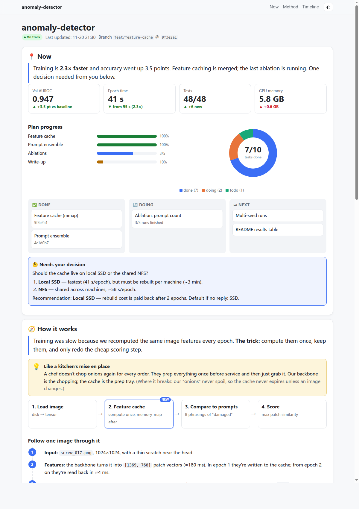
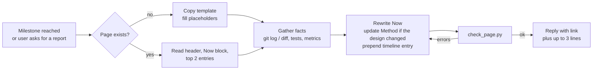

<div align="center">

# 📊 html-progress-report

**Let your coding agent keep a single living HTML page, so you can catch up on its work in about a minute.**

English · [简体中文](README.zh-CN.md)

[](LICENSE)


-purple)

[**▶ Live demo**](https://htmlpreview.github.io/?https://github.com/7HHHHH/html-progress-report-skill/blob/main/examples/demo.html)

<picture>
  <source media="(prefers-color-scheme: dark)" srcset="examples/screenshot-dark.png">
  
</picture>

</div>

---

## Why

Coding agents now run for hours across many sessions. When you come back, the usual
record is a long chat log, a pile of commits, and maybe a Markdown summary that is
already out of date. None of these quickly answers three questions:

> **Where are we? What changed since I last looked? Do I need to decide anything?**

This skill makes the agent keep **one HTML page per project** that answers those
questions on the first screen. The page explains the work in plain language and shows
it visually, so you can follow along without reading diffs.

## Features

| | |
|---|---|
| 📄 **One living page** | The page is updated in place, not regenerated as a new report each time. The agent rewrites the *Now* snapshot and **prepends** one timeline entry per milestone. Old entries are never deleted. |
| 🆕 **Catch-up mode** | Entries added since your last visit get a **NEW** tag. You can filter the timeline by tag (`feature`, `fix`, `experiment`, …) and search it. |
| 🗣 **Plain language** | Conclusion first; *what → why → result → next*; jargon is defined on first use; one-line analogies for mechanisms; numbers always shown with a comparison (`0.912 → 0.947`). |
| 🎨 **Vivid method explanations** | The *How it works* section follows a fixed recipe: the problem and idea in one sentence → an everyday **analogy** → a **diagram** → **one real example traced step by step with real values** → **why this design** (with rejected alternatives) → limits. The validator warns if any part is missing. |
| 📈 **Visual-first** | KPI cards, progress bars, task board, flow diagrams, before/after, line / bar / hbar / donut charts, sortable tables, file trees, colored diffs, collapsible details. Every timeline entry includes at least one visual. |
| 🧭 **"Needs your decision"** | Questions that block progress are pinned at the top. Each one lists the options, the trade-offs, the agent's recommendation, and what it will do by default if you don't answer. |
| 🧪 **Honest by design** | Every number must come from a command output or a file. Unverified claims carry an `unverified` badge. Dead ends get their own entries. |
| 🌐 **Your language** | The page is written in the language you are using with the agent. Code, paths, and metric names stay as they are. |
| 📦 **Zero dependencies** | The whole page is one HTML file with inline CSS and a ~150-line SVG chart renderer. It works offline over `file://`, has light and dark themes, and prints cleanly. Mermaid is supported as an optional extra. |
| 🛡 **Agent-safe edits** | HTML comment markers fence each region. A validator that uses only the Python standard library checks markers, chart JSON, entry metadata, and tag balance. |

## How it works



The page has four regions. Each one is fenced by markers, so the agent edits only what it should:

```
┌ header      status badge · last updated · branch@commit        → rewritten each update
├ 📍 Now      TL;DR · KPIs · task board · ⚠ needs your decision   → rewritten each update
├ 🧭 Method   analogy · diagram · worked example · why-this-design  → edited only when the approach changes
└ 🕒 Timeline newest first, one entry per milestone               → prepend only; archived after ~30 entries
```

## Install

This is a standard [Agent Skill](https://agentskills.io): a folder with a `SKILL.md`.
Clone it once, then link it into each agent's skills directory:

```bash
git clone https://github.com/7HHHHH/html-progress-report-skill.git ~/.agents/skills/html-progress-report
```

| Agent | Command |
|---|---|
| Claude Code | `ln -s ~/.agents/skills/html-progress-report ~/.claude/skills/html-progress-report` |
| Gemini CLI / Antigravity | `ln -s ~/.agents/skills/html-progress-report ~/.gemini/config/skills/html-progress-report` |
| Codex CLI | `ln -s ~/.agents/skills/html-progress-report ~/.codex/skills/html-progress-report` |
| Project-only | copy the folder to `<repo>/.agents/skills/` (or `<repo>/.claude/skills/`) |

> [!TIP]
> Some agents don't support skills natively. For those, add one line to `AGENTS.md`:
> *"When reporting progress, follow `~/.agents/skills/html-progress-report/SKILL.md`."*

## Usage

Just ask, in any language:

```text
Update the progress page.
Summarize what you did today and why.
汇报一下进展
```

Once a project has a page, the agent also updates it after each meaningful milestone.

- **Where:** `<repo>/.agent-progress/index.html`. Open it in a browser and keep the tab open; reload to see updates.
- **Git:** by default the page is added to `.git/info/exclude`, which keeps it out of git without changing your repo's `.gitignore`. To commit it instead, tell the agent or say so in your `AGENTS.md`.
- **Custom path:** say *"keep the progress page at `docs/progress.html`"* in your `AGENTS.md`.

## What's inside

```
SKILL.md                      instructions the agent follows (workflow, entry contract, rules)
assets/template.html          page skeleton: CSS, theme, NEW tags, filters, SVG charts
references/components.md      component catalog and a "which visual for what" table
references/writing-guide.md   how to write plain, scannable updates
scripts/check_page.py         validator (Python stdlib only)
examples/demo.html            filled example (see the live demo)
```

## Components at a glance

| You want to show… | Component |
|---|---|
| Headline numbers and how they changed | KPI cards |
| Plan / sub-task completion | Progress bars, donut |
| Done / doing / next | Task board |
| How a pipeline or method works | Flow (offline) or Mermaid |
| Old vs. new | Compare |
| Metric over time | Line chart (with optional target line) |
| Variants and ablations | Bar / hbar chart, sortable table |
| What files changed / the key code change | File tree, diff |
| Decision / risk / win / note | Callouts |

Charts are declared with plain data attributes. No library is needed:

```html
<div class="chart" data-type="line" data-title="Val AUROC" data-target="0.95"
  data-labels='["1","2","3","4","5"]'
  data-series='[{"name":"baseline","values":[0.88,0.90,0.91,0.91,0.912],"dashed":true},
                {"name":"ours","values":[0.89,0.92,0.94,0.945,0.947]}]'></div>
```

See [`references/components.md`](references/components.md) for every component and a copy-paste snippet for each.

## Validate a page

```bash
python3 scripts/check_page.py .agent-progress/index.html
# OK: 3 entries, 4 charts, 0 errors, 0 warnings
```

The validator checks for:

- missing or duplicated markers, and unfilled `{{PLACEHOLDERS}}`
- unbalanced tags, and invalid chart JSON
- entry metadata (`data-time` with timezone, tags, status, commit)
- newest-first order, entries with no visual, and timelines that should be archived

## FAQ

<details>
<summary><b>Why HTML instead of Markdown?</b></summary>

Markdown can't hold interactive charts, NEW-since-last-visit tags, filters, collapsible details, or a consistent dashboard layout. A single HTML file can, and it still opens anywhere with no build step.
</details>

<details>
<summary><b>Won't the agent burn tokens re-reading a huge file?</b></summary>

No. The agent reads only the header, the Now block, and the top 2 entries. It edits by marker instead of rewriting the file. Timelines longer than ~30 entries are moved to monthly archive pages.
</details>

<details>
<summary><b>Does it work offline?</b></summary>

Yes. Everything is inline. Only Mermaid diagrams need a network connection; when offline they fall back to showing the diagram source. The built-in `.flow` component covers most diagram needs offline.
</details>

<details>
<summary><b>Can I change the look?</b></summary>

Yes. All colors are CSS variables at the top of `assets/template.html`. Edit them once and every new page uses them.
</details>

## Contributing

Issues and PRs are welcome, especially new components, better chart types, and adapters for more agents.
Please keep the main rule: **single file, zero dependencies.** Run `check_page.py` on `examples/demo.html` before submitting.

## License

[MIT](LICENSE)
