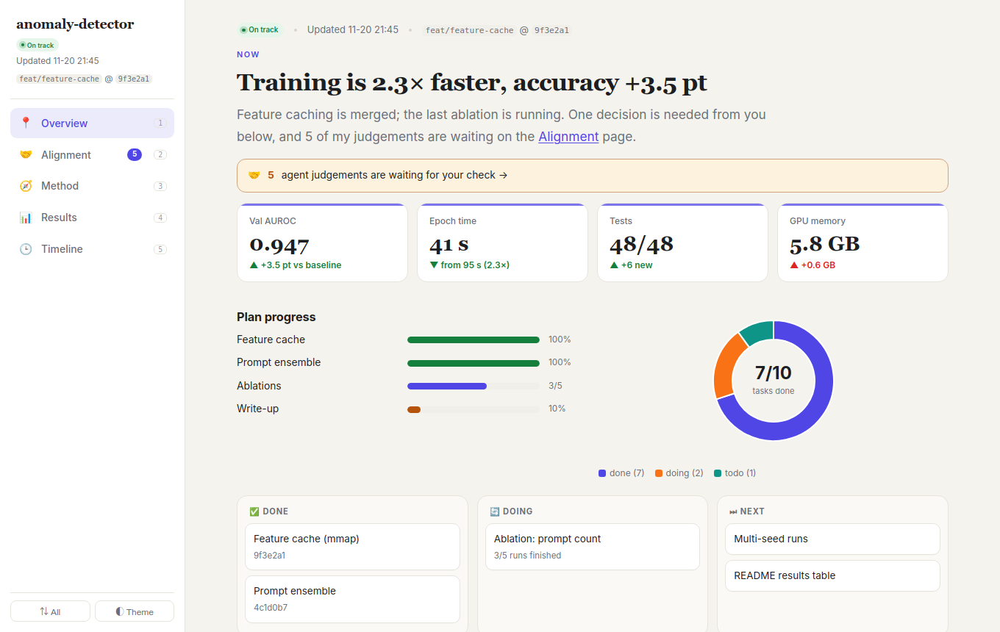
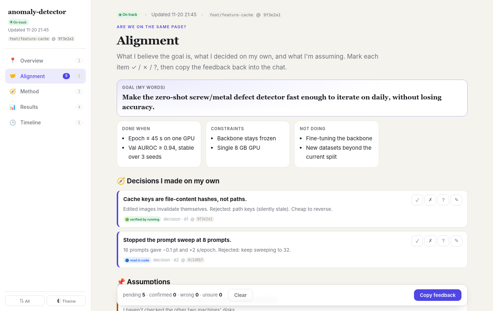
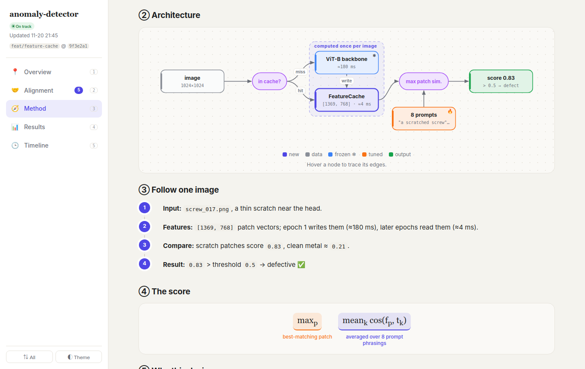
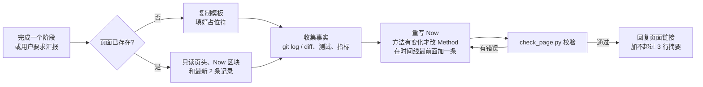

<div align="center">

# 📊 html-progress-report

**让 coding agent 维护一个持续更新的多页 HTML 进度报告：一分钟了解它做了什么，并核对它对目标的理解是否还和你一致。**

[English](README.md) · 简体中文

[](LICENSE)


-purple)

[**▶ 在线示例**](https://htmlpreview.github.io/?https://github.com/7HHHHH/html-progress-report-skill/blob/main/examples/demo.html)

<picture>
  <source media="(prefers-color-scheme: dark)" srcset="examples/screenshot-dark.png">
  
</picture>

 

</div>

---

## 为什么需要它

现在的 coding agent 经常一跑就是几个小时，中间还要跨好几个会话。等你回来，手上通常只有长长的对话记录、一堆 commit，也许还有一份早就过时的 Markdown 总结。这些都没法让你很快回答三个问题：

> **现在进展到哪了？上次看过之后改了什么？有没有需要我拍板的事？**

它们也回答不了最晚发现、代价最大的那个问题：**agent 对目标的理解，是否还和你一致。**

这个 skill 让 agent **每个项目只维护一个 HTML 文件**（内含多个页面），打开第一屏就能回答这三个问题，并把 agent 自己的理解摊开给你纠正。页面用大白话解释，再配上可视化，不用读 diff 也能跟上进度。

## 特性

| | |
|---|---|
| 🤝 **对齐页** | agent 用自己的话复述目标（并写明“不做什么”），再列出它自己拿的主意、依赖的假设、和你要求不一致的地方；每条都标证据等级（🟢 运行验证 · 🔵 读过代码 · ⚪ 来自文档 · 🟠 推测）。你逐条点 ✓ / ✗ / ? 并写备注，点 **复制反馈** 粘回对话，agent 据此修正 |
| 🗂 **分页，而不是一条长滚动** | 概览 · 对齐 · 方法 · 结果 · 时间线，左侧边栏切换（数字键 `1`–`9`）；图表和架构图在打开对应页时才渲染；“全部”按钮可把所有页摊开，方便搜索和打印 |
| 📄 **只有一个文件** | 不会每次都生成一份新报告。agent 每次重写“当前状态（Now）”，并在时间线**最前面**加一条记录，旧记录永不删除 |
| 🆕 **快速跟进** | 上次查看之后新增的记录会标 **NEW**；时间线可以按标签（`feature`、`fix`、`experiment` 等）筛选，也可以全文搜索 |
| 🗣 **通俗易懂** | 先说结论，按“做了什么 → 为什么 → 结果 → 下一步”写；术语第一次出现要解释，复杂机制配一句类比；数字一定给出对比（`0.912 → 0.947`） |
| 🎨 **方法页以图为主** | 一句话核心思想 → 新旧流程对比（被去掉的步骤划掉）→ 由 JSON 生成的**架构图**（离线 SVG，冻结/可训练/输出分色，节点可放真实图片，悬停高亮连线）→ 用**真实图片/热力图串成一个例子**并给出判定 → 逐项注释的**公式** → 带“放弃了什么”的**设计理由**卡片 → 局限。方法页文字过多时校验脚本会警告 |
| 📈 **可视化优先** | 指标卡、进度条、任务看板、流程图、改前改后对比、折线图、柱状图、横向条形图、环形图、可排序表格、文件树、彩色 diff、折叠详情。每条时间线至少带一个图 |
| 🧭 **“需要你决定”置顶** | 卡住进度的问题固定在页面顶部，写明有哪些选项、各自的利弊、agent 的推荐，以及你不回复时它默认怎么做 |
| 🧪 **如实记录** | 页面上每个数字都必须来自命令输出或文件；没验证过的标 `unverified`；走不通的尝试也单独记一条 |
| 🌐 **跟随你的语言** | 你用什么语言和 agent 对话，页面就用什么语言写；代码、路径、指标名保持原样 |
| 📦 **零依赖** | 整个页面就是一个 HTML 文件，CSS 和一个约 150 行的 SVG 图表渲染器都写在文件里。双击就能离线打开，默认暖色浅色主题（可手动切到深色），也能直接打印。Mermaid 是可选项 |
| 🛡 **改动安全** | 每个区块都用 HTML 注释标记围起来，agent 只改标记里的内容；附带一个只用 Python 标准库的校验脚本 |

## 工作原理



文件由页头和五个页面组成：

```
┌ 页头      状态徽章 · 更新时间 · 分支@commit                → 每次更新都重写
├ 📍 概览   一句话总结 · 指标 · 看板 · ⚠ 需要你决定          → 每次更新都重写
├ 🤝 对齐   目标卡 · 自己拿的主意 · 假设 · 偏离 · 问题        → 每次更新；你的 ✓/✗ 会被反馈回来
├ 🧭 方法   核心思想 · 新旧对比 · 架构图 · 真实例子 · 公式 · 设计理由 → 只有方法变了才改
├ 📊 结果   图表 · 表格 · 消融                                → 有新证据时更新
└ 🕒 时间线 最新的在最上面，一个阶段一条                      → 只加不删，超过约 30 条就归档
```

## 安装

这是一个标准的 [Agent Skill](https://agentskills.io)，也就是一个包含 `SKILL.md` 的文件夹。先 clone 一次，再软链接到各个 agent 的 skills 目录：

```bash
git clone https://github.com/7HHHHH/html-progress-report-skill.git ~/.agents/skills/html-progress-report
```

| Agent | 命令 |
|---|---|
| Claude Code | `ln -s ~/.agents/skills/html-progress-report ~/.claude/skills/html-progress-report` |
| Gemini CLI / Antigravity | `ln -s ~/.agents/skills/html-progress-report ~/.gemini/config/skills/html-progress-report` |
| Codex CLI | `ln -s ~/.agents/skills/html-progress-report ~/.codex/skills/html-progress-report` |
| 只给某个项目用 | 把文件夹复制到 `<repo>/.agents/skills/`（或 `<repo>/.claude/skills/`） |

> [!TIP]
> 有些 agent 不直接支持 skill。对它们，在 `AGENTS.md` 里加一句即可：
> *“汇报进展时，按照 `~/.agents/skills/html-progress-report/SKILL.md` 执行。”*

## 使用

直接说就行，用什么语言都可以：

```text
汇报一下进展
总结一下今天做了什么、为什么这么做
Update the progress page.
```

项目里有了进度页以后，agent 每完成一个重要阶段也会自己去更新。

- **位置：** `<repo>/.agent-progress/index.html`。在浏览器里开着这个标签页，刷新就能看到最新内容。
- **Git：** 默认把它加进 `.git/info/exclude`，不进版本库，也不会改动项目的 `.gitignore`。想提交的话，告诉 agent 或写进 `AGENTS.md`。
- **自定义路径：** 在 `AGENTS.md` 里写一句“进度页放在 `docs/progress.html`”。

## 目录结构

```
SKILL.md                      agent 要遵循的说明（流程、时间线条目格式、规则）
assets/template.html          页面骨架：样式、主题、NEW 标记、筛选、SVG 图表
references/components.md      组件目录，以及“想展示什么 → 用哪个组件”对照表
references/writing-guide.md   怎么写出通俗、好扫读的更新
scripts/check_page.py         校验脚本（只用 Python 标准库）
examples/demo.html            填好内容的示例（就是在线示例那个页面）
```

## 组件一览

| 想展示…… | 组件 |
|---|---|
| 关键数字及其变化 | 指标卡 |
| 计划或子任务完成度 | 进度条、环形图 |
| 已完成 / 进行中 / 下一步 | 任务看板 |
| 方法或流程怎么运作 | Flow（离线可用）或 Mermaid |
| 改前 vs 改后 | 对比卡片 |
| 指标随时间的变化 | 折线图（可加目标线） |
| 不同方案、消融实验 | 柱状图、横向条形图、可排序表格 |
| 改了哪些文件、关键代码改动 | 文件树、diff |
| 决策、风险、好消息、备注 | 提示框 |

图表用普通的 data 属性声明，不需要任何库：

```html
<div class="chart" data-type="bar" data-title="消融实验"
  data-labels='["完整","−缓存","−提示集成"]'
  data-series='[{"name":"AUROC","values":[94.7,94.6,92.1]}]' data-unit="%"></div>
```

每个组件的可直接复制的代码片段见 [`references/components.md`](references/components.md)。

## 校验页面

```bash
python3 scripts/check_page.py .agent-progress/index.html
# OK: 3 entries, 4 charts, 0 errors, 0 warnings
```

校验内容：

- 标记缺失或重复、还有没填的 `{{占位符}}`
- 标签没闭合、图表数据不是合法 JSON
- 每条记录的元数据：带时区的 `data-time`、标签、状态、commit
- 记录是否按最新在前排列、有没有不带图的记录、时间线是否该归档了

## 常见问题

<details>
<summary><b>为什么用 HTML 而不是 Markdown？</b></summary>

Markdown 放不了交互图表、NEW 标记、筛选、折叠详情，也很难保持统一的仪表盘布局。单个 HTML 文件这些都能做到，而且不用构建，在哪都能打开。
</details>

<details>
<summary><b>文件越来越大，agent 会不会很费 token？</b></summary>

不会。agent 每次只读页头、Now 区块和最新 2 条记录，并按标记做局部修改，不会整份重写。时间线超过约 30 条后，旧记录会按月移到归档页。
</details>

<details>
<summary><b>能离线用吗？</b></summary>

能，所有内容都在文件里。只有 Mermaid 图需要联网，断网时会显示图的源码。内置的 `.flow` 组件离线也能画大部分流程图。
</details>

<details>
<summary><b>能改样式吗？</b></summary>

能。所有颜色都是 `assets/template.html` 顶部的 CSS 变量，改一次，之后新建的页面都会用新样式。
</details>

## 参与贡献

欢迎提 Issue 和 PR，尤其是新组件、更好的图表类型，以及对更多 agent 的适配。请保持核心原则：**单文件、零依赖**。提交前请用 `check_page.py` 跑一遍 `examples/demo.html`。

## 许可证

[MIT](LICENSE)
